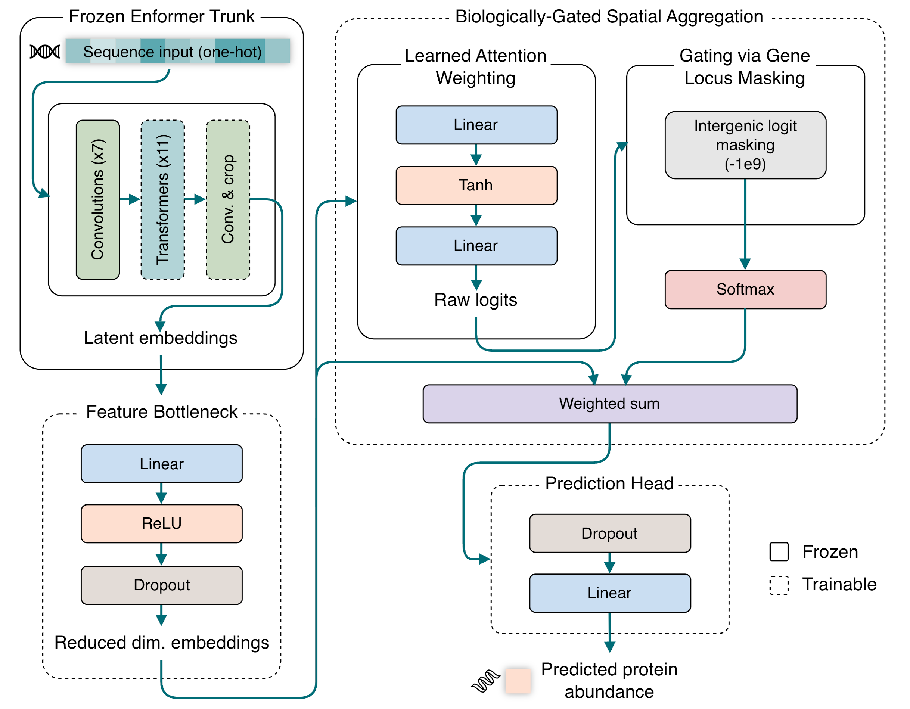
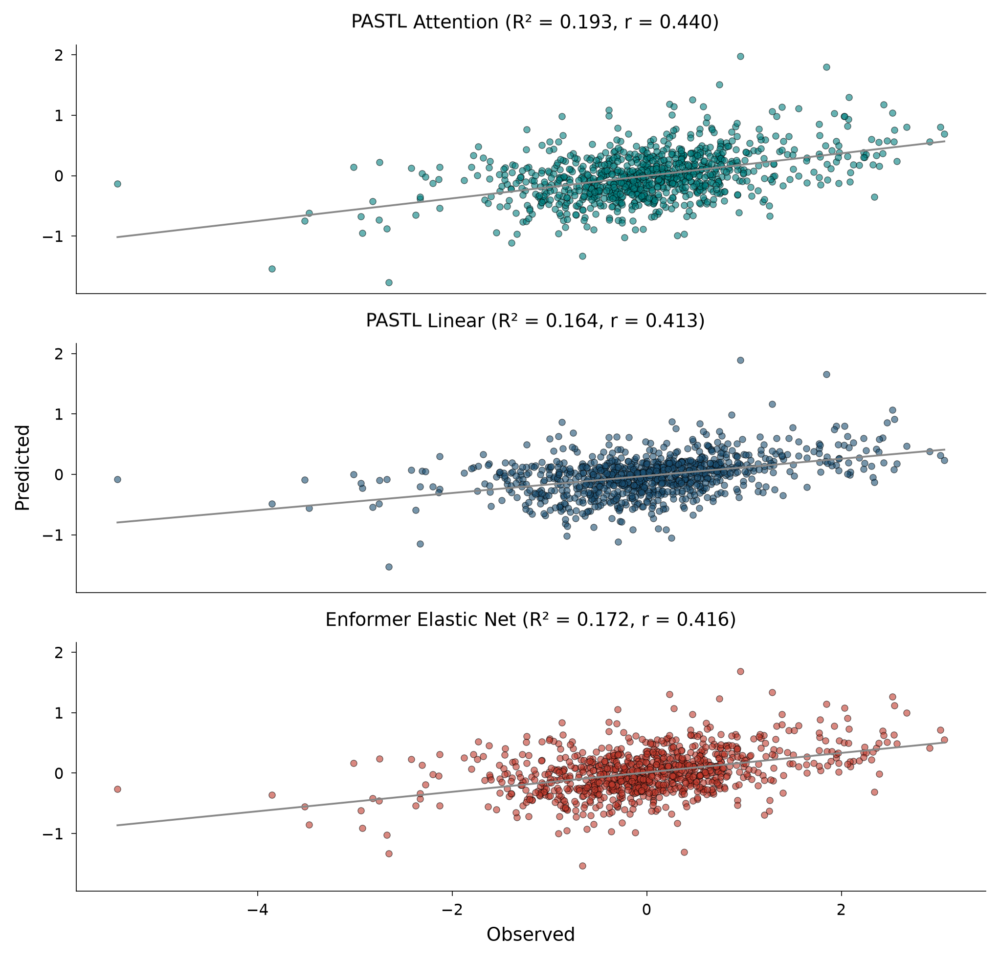
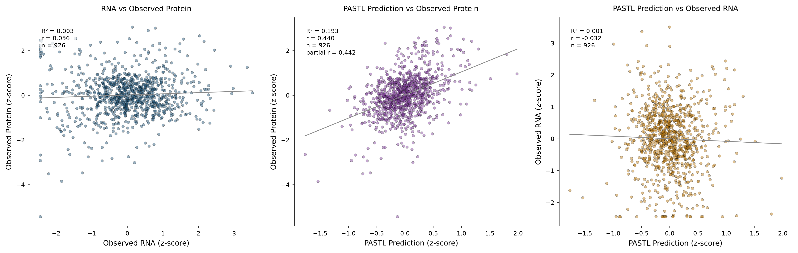
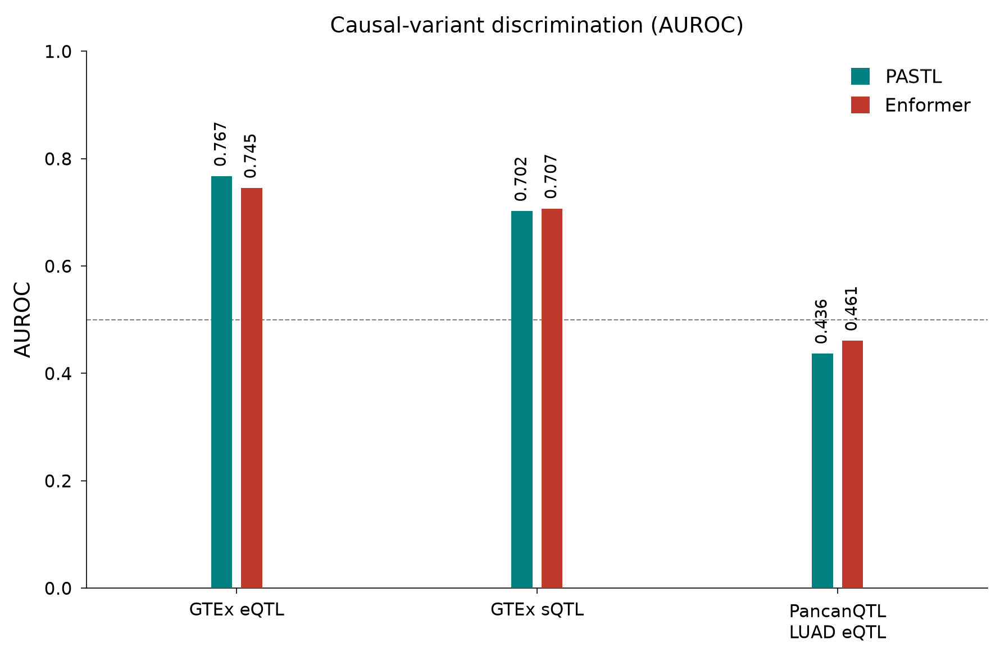
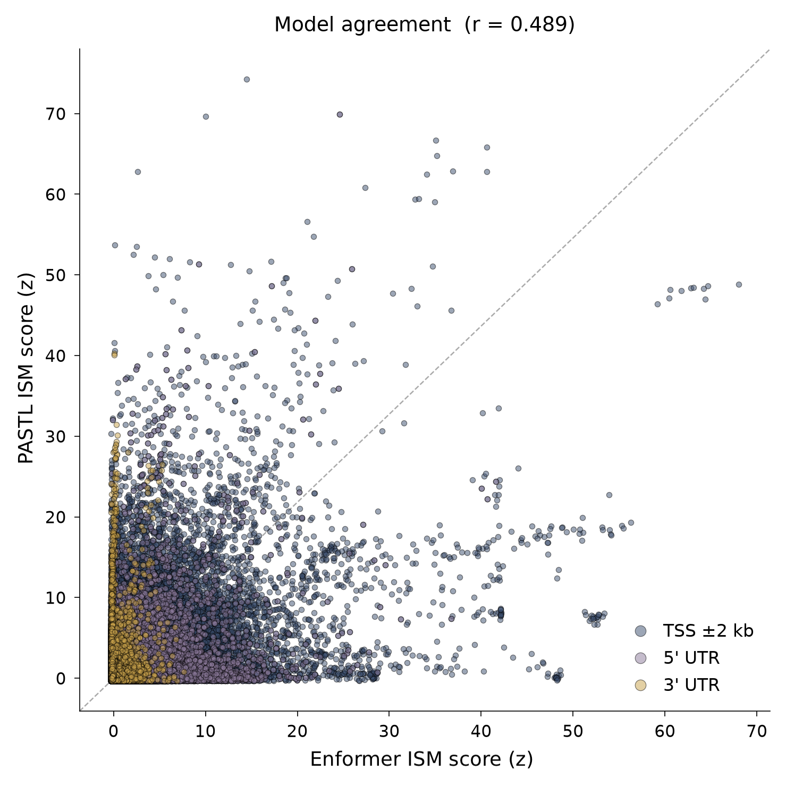
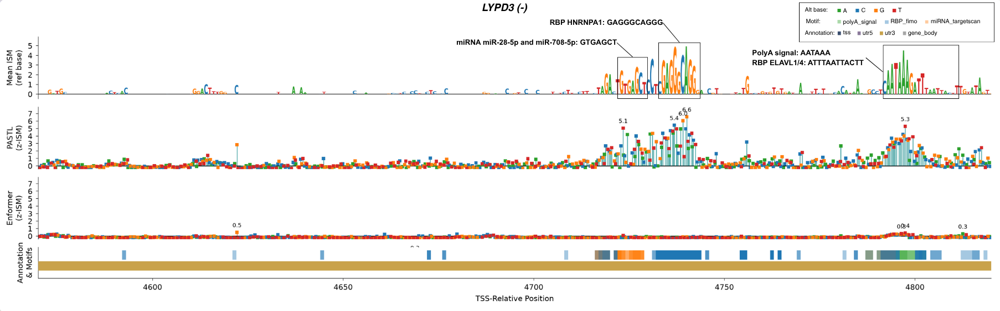
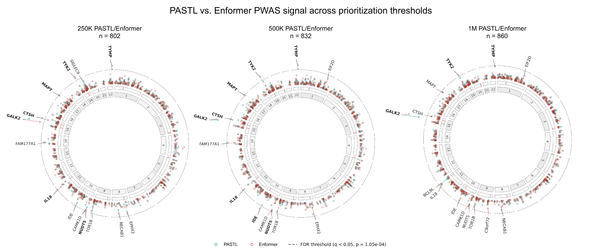

# <br>PASTL: Protein Abundance from Sequence via Transfer Learning

PASTL is a PyTorch transfer-learning pipeline that fine-tunes a genomic foundation model 
with a custom biologically-gated attention head. It predicts steady-state protein abundance 
directly from raw DNA sequence. It is based on the genomic model [Enformer](https://www.nature.com/articles/s41592-021-01252-x). PASTL 
quantifies how much of the across-protein variation in abundance (averaged over a patient 
cohort) is encoded in the *cis*-regulatory DNA sequence around each gene.


## Background

PASTL tests whether the sequence representations learned by a large pretrained 
genomics model generalize to a target it was never trained on (scalar steady-state 
protein abundance). The result reveals how much of that transfer reflects genuine 
post-transcriptional regulation. Its backbone, Enformer, is pre-trained to predict 
functional genomics tracks (CAGE, DNase, ChIP, and related assays) from sequence.

Two considerations motivate this design:

- **Direct sequence-to-abundance mapping** avoids the compounding error of chained 
  intermediate predictors (DNA → RNA → protein) and exposes sequence features that 
  act on abundance post-transcriptionally.
- **Transfer learning** addresses a data-scarcity problem. Protein abundance labels 
  are sparse (one scalar value per protein) so training from scratch risks overfitting 
  and discards spatial signal when a 196,608 bp window is collapsed to a single number. 
  Reusing Enformer's pre-compressed [896, 3072] spatial embeddings (128 bp resolution) 
  preserves the regulatory resolution needed for the new task.

> **Note on data.** This repository contains code and lightweight reference files
> only. The proteomics labels (CPTAC), reference genome, GTEx/GENCODE annotations,
> GWAS/QTL summary statistics, and trained checkpoints are **not** included. Several
> are large and/or under controlled access. All input and output locations are
> passed explicitly as command-line arguments so the pipeline can be pointed at
> local data directories.

## Method overview

<br>
<em>The PASTL biologically-gated spatial aggregation transfer learning head isolates
cis-regulatory information from Enformer for protein abundance prediction. A one-hot
encoded DNA sequence is passed to the Enformer model. Enformer's weights are
selectively fine-tuned (the transformer and final convolution layers). The extracted
embeddings are sequentially passed through the transfer learning model consisting of a
feature bottleneck, a spatial aggregation block utilizing learned attention weighting
and biological masking, and a linear prediction head to compress embeddings into a
final protein abundance prediction.</em>

- **Task.** Predict per-protein mean log2 abundance (z-scored) across CPTAC LUAD
  solid-tissue-normal patients from a 196,608 bp DNA window centred on the gene's
  (CAGE-refined) transcription start site.
- **Backbone.** Pre-trained `EleutherAI/enformer-official-rough`, mapping one-hot DNA
  `[B, 196608, 4]` to embeddings `[B, 896, 3072]` (896 bins at 128 bp resolution).
- **Head.** Biologically-gated spatial aggregation with learned attention weighting:
  a 3072→256 feature bottleneck, per-bin attention score, a gene-locus mask that
  restricts attention to bins overlapping the target transcript, and a linear
  read-out to a single prediction. A central-bin linear head is provided as an ablation.
- **Training.** Two-stage fine-tuning (frozen trunk → unfrozen blocks) with
  differential learning rates (trunk 100× lower than head), cosine schedule,
  bfloat16 autocast, and activation checkpointing.
- **Baseline.** *Enformer-ElasticNet*: Enformer run frozen as a static feature
  extractor with a grid-searched ElasticNet regressor.
- **Splits.** Enformer's canonical train/valid/test chromosome partitioning is
  inherited directly; proteins whose prediction window spans two splits are dropped
  to prevent leakage.

## Results

### Prediction accuracy

<br>
<em>Fine-tuning with the attention head captures cis-regulatory signals more accurately
than linear prediction or frozen feature extraction. Predicted versus observed
z-scored mean protein abundance on the Enformer held-out test set. PASTL Attention
achieves R² = 0.193 and Pearson r = 0.440. This outperforms both the PASTL central-bin
linear ablation model (R² = 0.164, r = 0.413) and the Enformer Elastic Net baseline
trained on frozen trunk embeddings (R² = 0.172, r = 0.416).</em>

### Variance decomposition

<br>
<em>PASTL sequence-based predictions capture post-transcriptional variation in
steady-state protein abundance. Cross-gene Pearson correlations compare observed
RNA, observed protein, and model predictions on the held-out test set (n = 926 genes).
Observed RNA is the per-gene median log₂(TPM+1); observed protein is the training
label; both are z-scored across genes. The baseline cross-gene RNA-protein
correlation is deflated because Tandem Mass Tag (TMT) normalization removes
absolute-level information across genes, which z-scoring cannot restore. A partial
correlation of predictions versus observed protein, controlling for transcript
level, isolates the post-transcriptional signal captured by the model.</em>

### Zero-shot variant effects

<br>
<em>PASTL preserves transcriptional-regulatory variant sensitivity. Causal-variant
discrimination (AUROC) was evaluated for SuSiE fine-mapped quantitative trait loci
(QTLs). Model performance is compared against the Enformer baseline using GTEx v8
lung eQTLs, GTEx sQTLs, and PancanQTL LUAD eQTLs. Causal variants with a posterior
inclusion probability (PIP) &gt; 0.9 are discriminated from spurious variants (PIP &lt; 0.01)
using absolute predicted effect magnitudes. PASTL achieves comparable AUROC to
Enformer for GTEx eQTLs (0.767 vs. 0.745) and sQTLs (0.702 vs. 0.707), while both
models are below 0.5 for PancanQTL LUAD eQTLs.</em>

### In silico saturation mutagenesis (ISM)

<br>
<em>PASTL is more sensitive to 3' UTR mutations. Comparison of z-scored ISM scores
from PASTL and Enformer. Single nucleotide substitutions are stratified by
regulatory region annotation. Highly disruptive 3' UTR variants shift towards PASTL.</em>


*Locus-specific in silico mutagenesis track for the LYPD3 gene. Top: a reference
sequence logo plot quantifying the mean PASTL ISM score. Centre two plots: lollipop
plots illustrating variant-specific mutational sensitivities for PASTL (top) and
Enformer (bottom). Bottom: an annotation track that aligns mutational sensitivities
with transcribed genomic regions and identified functional motifs. PASTL identifies
miRNA target, RBP, and polyadenylation-associated sensitivity in the LYPD3 3'UTR.
PASTL's ISM profile for LYPD3 shows two clusters of mutational sensitivity not
detected by Enformer. The primary cluster (~4712-4744) aligns with overlapping
miRNA target sites (hsa-miR-27a-3p, hsa-miR-27b-3p, hsa-miR-128-3p, hsa-miR-28-5p,
hsa-miR-708-5p; TargetScan) and a dense RBP binding cluster (HNRNPA1, SRSF1,
HNRNPF/H1/H2/H3, PCBP1/2, SRSF2; ATtRACT/FIMO). A secondary cluster (~4786-4823)
aligns with an additional RBP site (NOVA2, ELAVL1/4) and a polyadenylation signal.
Enformer shows minimal sensitivity across both regions.*

### Proteome-wide association


*Comparative genome-wide PWAS signal. Circos scatter plots display per-gene PWAS
-log10 p-values for PASTL and Enformer across (left to right) 250K, 500K, and 1M
variant prioritization thresholds. The outermost ring illustrates model-specific
associations relative to a Benjamini-Hochberg (BH) false discovery rate (FDR)
threshold of q < 0.05. The intermediate ring indicates confirmed lung adenocarcinoma
GWAS loci (OpenGWAS ID: ebi-a-GCST004744). Genes exceeding the significance
threshold in either model are annotated radially in bold text.*

## Repository layout

| Path | Contents |
| --- | --- |
| `model/` | Model, dataset, config, training/evaluation, and tests |
| `model/configs/` | Example fine-tuning config |
| `preprocessing/` | Build the sequence BED and median-TPM inputs |
| `analysis/` | Prediction and downstream analyses (see below) |
| `data/` | Lightweight reference files (sequence BED, Enformer intervals/targets) |
| `figures/` | Result figures referenced by this README |
| `palette.py`, `pastl.mplstyle` | Shared plotting style |

### Analyses (`analysis/`)

- `predict.py`, `predict_variants.py` — generate model / Enformer predictions
- `correlation_eval/` — observed-vs-predicted accuracy and the ElasticNet baseline
- `egene_eval/`, `stratified_correlation/` — GTEx eGene stratified evaluation
- `decomp/` — RNA / protein / prediction variance decomposition
- `go_enrichment/` — GO over-representation of prediction residuals
- `gwas/`, `qtl/` — zero-shot variant-effect scoring against GWAS / fine-mapped QTLs
- `ism/` — in silico saturation mutagenesis and motif intersection
- `pwas/` — proteome-wide association study (imputation models + validation)
- `patient_correlation/` — patient-specific predicted-vs-measured correlation
- `weight_correlation/` — attention-weight vs genomic-feature analysis (attention head)

## Usage

All scripts use `argparse`; run any with `-h` to see its inputs and outputs. Paths
default to repository-relative locations (e.g. `out/predictions`) and can be
overridden on the command line. Example:

```bash
python analysis/predict.py \
    --config model/configs/config.yaml \
    --mode pastl \
    --wandb_run_id <run_id> \
    --checkpoints_dir /path/to/checkpoints \
    --predictions_dir /path/to/out/predictions
```

## Dependencies

See `requirements.txt`. Core stack: PyTorch, `enformer-pytorch`, NumPy/pandas,
scikit-learn, matplotlib.

## License

Released under the [MIT License](LICENSE).
