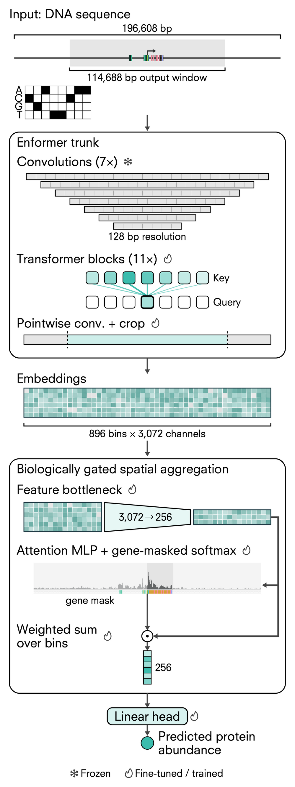
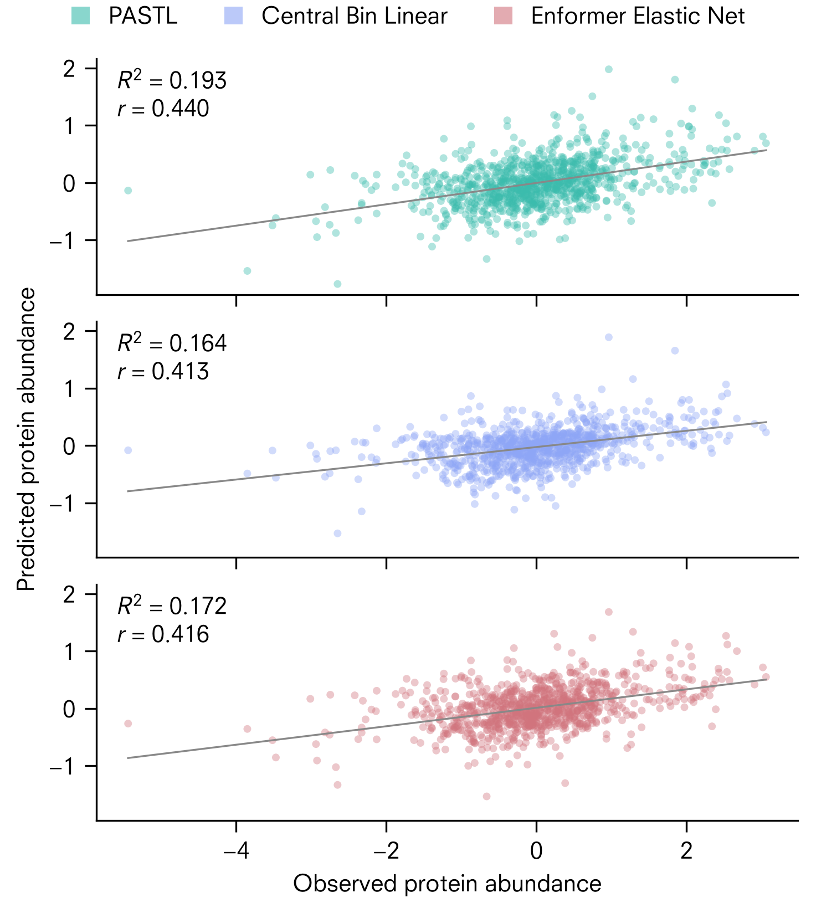
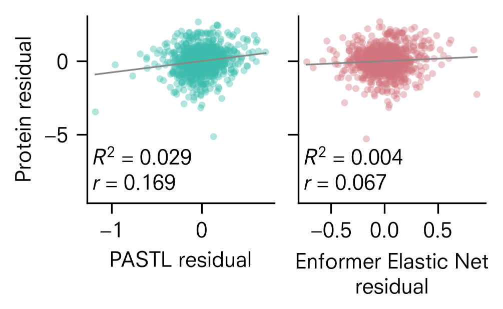
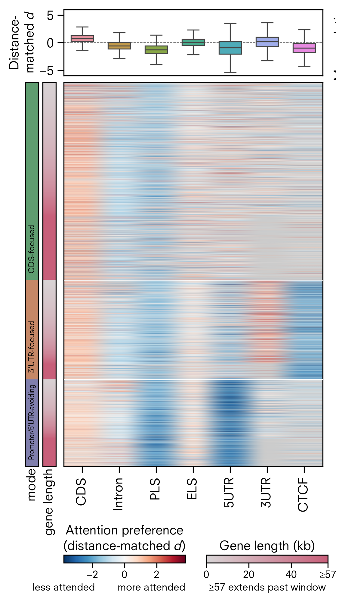
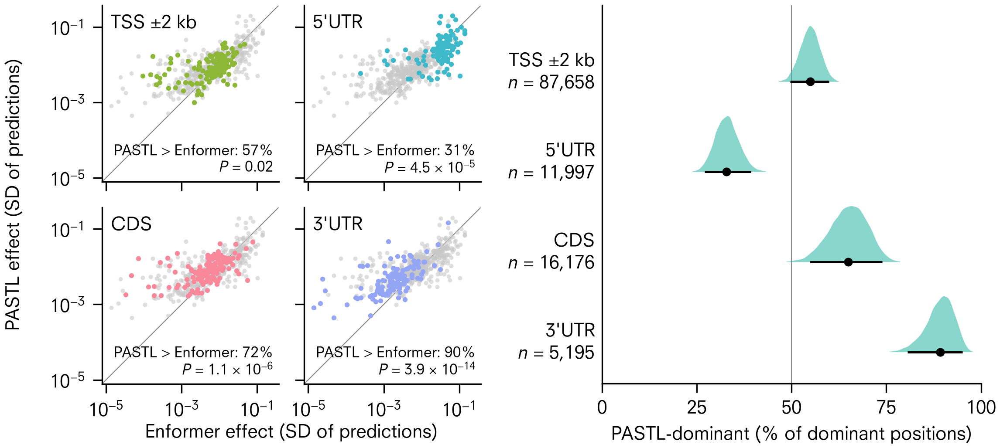
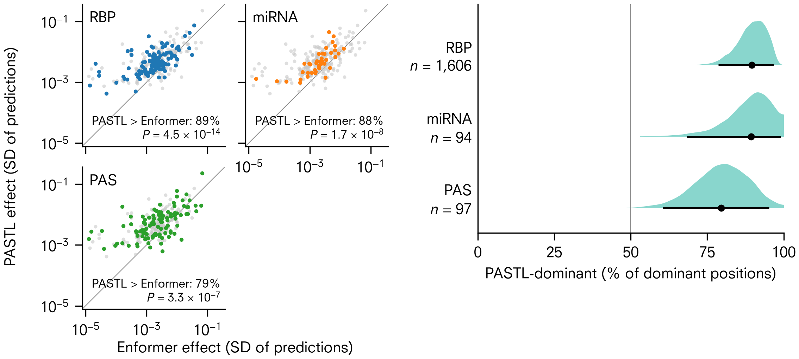
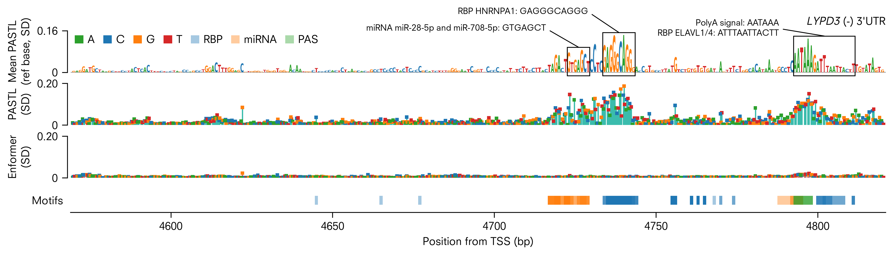
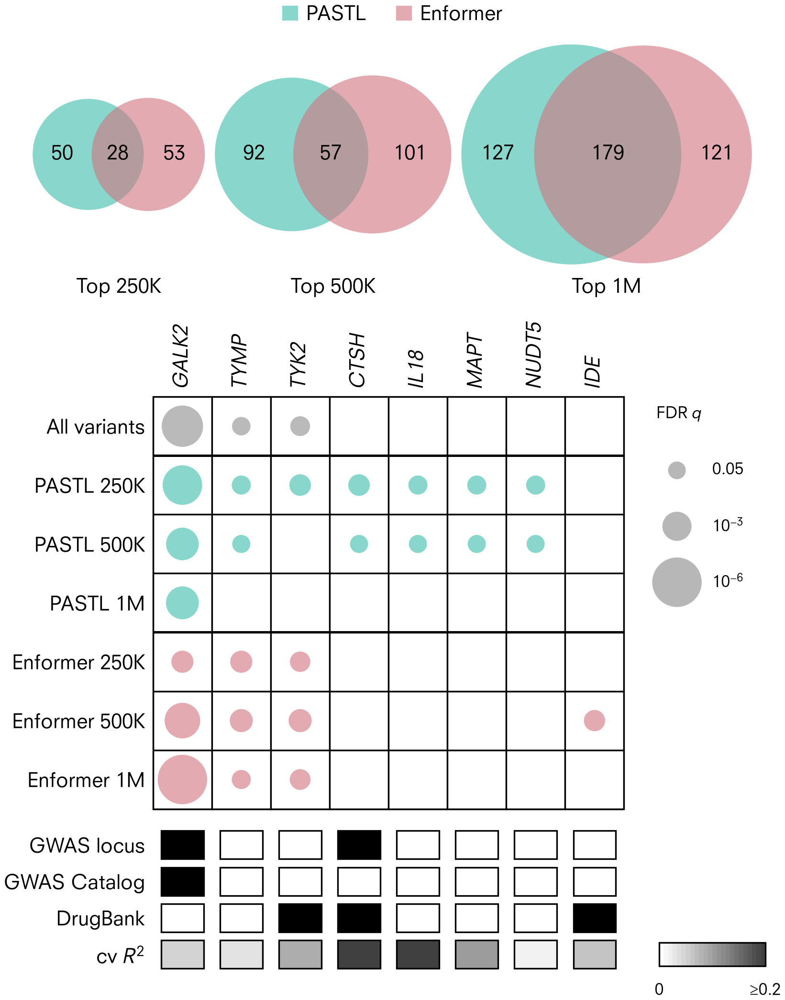
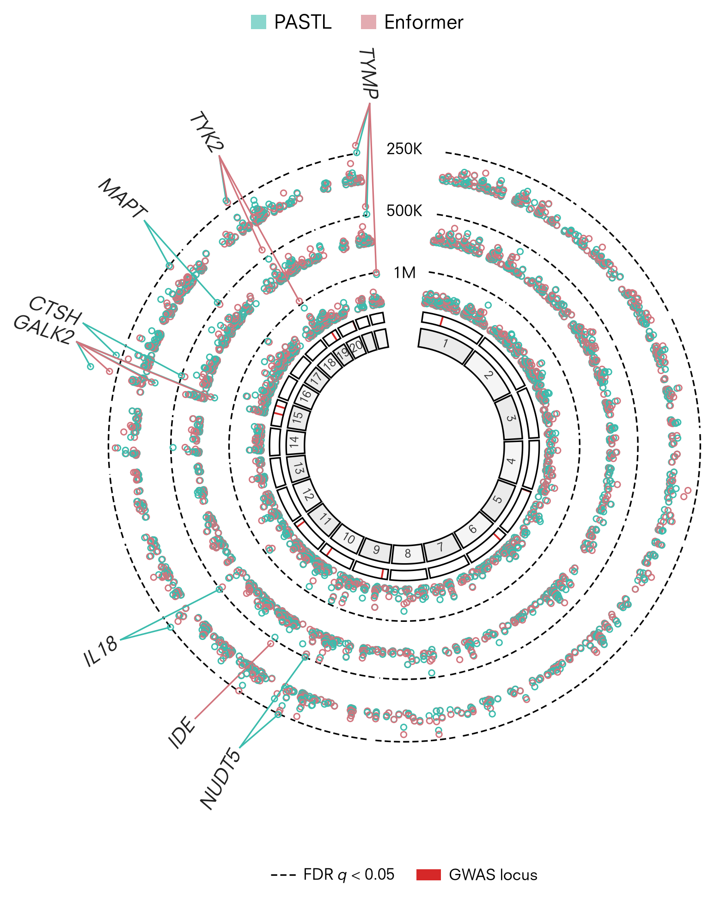

# <br>PASTL: Protein Abundance from Sequence via Transfer Learning

PASTL fine-tunes the genomic foundation model [Enformer](https://www.nature.com/articles/s41592-021-01252-x)
to predict steady-state protein abundance directly from DNA sequence. Enformer is pretrained
on transcriptional readouts. Retargeting it to protein abundance changes what it learns. The
fine-tuned model becomes more sensitive to post-transcriptional regulatory sequence in the
coding sequence and 3′ UTR, while keeping its sensitivity at the promoter. Its variant scores
then act as a complementary functional prior for proteome-wide association testing.


> **Manuscript in preparation.** Chernenkoff, S., Enoma, D., Weeraman, J. & Long, Q.
> *Transfer learning reveals post-transcriptional sequence determinants of protein abundance* (2026).

## Background

Proteins are the functional output of the genome. Their steady-state abundance is set by
transcription and by post-transcriptional control of mRNA stability, translation and protein
turnover. Sequence-to-expression models such as Enformer predict mRNA well, but mRNA explains
only part of the variation in protein. Three considerations shape PASTL:

- **Chaining compounds error.** A DNA → RNA → protein pipeline multiplies the error of each
  stage. It also cannot expose sequence features that act after transcription. Mapping
  directly from sequence to protein makes those features visible to the model.
- **Sparse labels defeat training from scratch.** Protein abundance gives one scalar per gene.
  Collapsing a 196,608 bp input to a single number on ~10,000 examples overfits and discards
  the spatial structure that regulatory inference depends on.
- **Transfer learning resolves the tension.** Enformer's pretrained spatial embeddings
  (896 bins × 3,072 features at 128 bp resolution) supply regulatory resolution that the label
  set could never support on its own. The new task only has to learn how to weight and
  aggregate that representation.

> **Note on data.** This repository contains code and lightweight reference files
> only. The proteomics labels (CPTAC), reference genome, GTEx/GENCODE annotations,
> GWAS/QTL summary statistics, and trained checkpoints are **not** included. Several
> are large and/or under controlled access. All input and output locations are
> passed explicitly as command-line arguments so the pipeline can be pointed at
> local data directories.

## Method overview

<br>
<em><b>PASTL retargets Enformer to a scalar protein abundance prediction through a
biologically gated spatial aggregation head.</b> A one-hot 196,608 bp sequence centred on
the transcription start site (TSS) passes through the Enformer trunk. The convolution tower
stays frozen, and the transformer blocks and final pointwise convolution are fine-tuned. The
resulting 896 × 3,072 embedding passes through a feature bottleneck (3,072 → 256). An
attention MLP scores every 128 bp bin, and a gene-locus mask restricts the softmax to bins in
the target gene body. The weighted sum of bins feeds a linear head that predicts cohort-mean
protein abundance.</em>

- **Task.** Predict per-protein mean log2 abundance (z-scored) across CPTAC LUAD
  normal-adjacent tissue from a 196,608 bp window centred on the CAGE-refined TSS of the
  dominant lung isoform (10,100 proteins).
- **Backbone.** Pretrained Enformer (`EleutherAI/enformer-official-rough`), mapping one-hot DNA
  `[B, 196608, 4]` to embeddings `[B, 896, 3072]`.
- **Training.** Staged unfreezing: the head trains alone for 10 epochs (803K parameters),
  then the transformer and final convolution blocks are unfrozen (180M trainable parameters).
  AdamW with a trunk learning rate 15× below the head and cosine decay, bfloat16 autocast and
  activation checkpointing, trained on a single A100 GPU.
- **Comparators.** *Enformer Elastic Net*, an elastic net on frozen Enformer embeddings, and
  *Central Bin Linear*, a linear readout of the single TSS bin.
- **Splits.** Enformer's own train/validation/test genomic intervals are inherited directly
  (8,429 / 745 / 926 proteins). Proteins whose window spans two splits are removed to prevent
  leakage.

## Results

### Protein abundance is predictable from DNA sequence alone

<br>
<em><b>PASTL predicts held-out protein abundance from sequence alone, with improved accuracy
over both comparators.</b> Observed versus predicted z-scored protein abundance on the
held-out test set (n = 926 genes) for PASTL (R² = 0.193, r = 0.440), Central Bin Linear
(R² = 0.164, r = 0.413) and Enformer Elastic Net (R² = 0.172, r = 0.416). Grey lines are
least-squares fits.</em>

### Fine-tuning captures signal that frozen representations do not

<br>
<em><b>PASTL's predictions carry protein-abundance signal that is not encoded in frozen
Enformer representations.</b> Left: protein abundance against PASTL predictions, each after
regressing out the Enformer Elastic Net predictions (R² = 0.029, r = 0.169). Right: the
reverse conditioning (R² = 0.004, r = 0.067). PASTL retains unique explanatory signal, so the
fine-tuned model is not a noisier copy of the frozen one.</em>

PASTL's advantage is largest for genes whose protein abundance is only weakly to moderately
predicted by their mRNA levels (abundance-adjusted trend P = 0.011). This is where
transcription-optimized representations are expected to fall short.

### Learned attention prefers coding sequence and avoids promoter-like elements

<br>
<em><b>At matched distance from the TSS, PASTL's attention prefers coding sequence and avoids
promoter-like sequence, and genes fall into three attention modes.</b> Top: attention
preference by genomic feature, as Cohen's d of log attention weight (feature vs. non-feature
bins) computed within ~1 kb strata of distance to the TSS (n = 9,204 genes). Median d: CDS
+0.76, 3′ UTR +0.19, ELS +0.09, intron −0.56, 5′ UTR −0.93, CTCF −0.94, PLS −1.32. Bottom:
each row is one gene, grouped by hierarchical clustering into CDS-focused, 3′ UTR-focused and
promoter/5′ UTR-avoiding modes. Attention favours sequence retained in mature mRNA over
sequence spliced out. GENCODE features: CDS, intron, 5′ UTR, 3′ UTR. ENCODE cCREs: PLS
(promoter-like), ELS (enhancer-like), CTCF-bound.</em>

### Fine-tuning shifts mutational sensitivity to the CDS and 3′ UTR

Every single-nucleotide substitution was scored by in silico saturation mutagenesis (ISM) in
the TSS ±2 kb window, 5′ UTR, CDS and 3′ UTR of 150 held-out test genes. Each model's effects
are expressed in standard deviations (SD) of its own predictions, so the two models can be
compared directly.

<br>
<em><b>PASTL matches Enformer's mutational sensitivity at the TSS and exceeds it in the CDS
and 3′ UTR.</b> Left: per-gene mean effect per substitution, PASTL against Enformer, for each
region (grey points are genes from the other regions). PASTL has the larger effect in 57% of
genes at the TSS ±2 kb (P = 0.02), 72% in the CDS (P = 1.1 × 10⁻⁶) and 90% in the 3′ UTR
(P = 3.9 × 10⁻¹⁴; paired Wilcoxon), with median PASTL/Enformer ratios of 1.1, 1.6 and 2.3.
Right: share of each region's dominant positions that are PASTL-dominant, with the bootstrap
distribution (shaded), estimate (dot) and 95% CI (line). In the 3′ UTR, 89% of dominant
positions are PASTL-dominant.</em>

<br>
<em><b>The gain extends to post-transcriptional regulatory motifs in the 3′ UTR.</b> As above,
for 3′ UTR bases inside RNA-binding protein (RBP) motifs (ATtRACT), predicted miRNA target
sites (TargetScan) and polyadenylation signals (PAS). PASTL has the larger effect in 89%,
88% and 79% of genes (P = 4.5 × 10⁻¹⁴, 1.7 × 10⁻⁸ and 3.3 × 10⁻⁷), with median
PASTL/Enformer ratios of 2.1, 2.3 and 2.4. Right: 90%, 89% and 80% of dominant motif
positions are PASTL-dominant.</em>

<br>
<em><b>In the LYPD3 3′ UTR, PASTL's sensitivity concentrates at a miRNA target site, an RBP
motif and a polyadenylation signal, where Enformer's effects are minimal.</b> Top: reference
sequence, with letter height equal to the mean PASTL effect of the three substitutions at
each base. Boxes mark a miR-28-5p/miR-708-5p target site (GTGAGCT), an HNRNPA1 motif
(GAGGGCAGGG), and a polyadenylation signal (AATAAA) next to an ELAVL1/ELAVL4 motif. Middle:
effect of each substitution for PASTL and for Enformer on a shared axis, coloured by the
substituted base. Bottom: RBP, miRNA and PAS sites. Every base in the miRNA and HNRNPA1 boxes
is PASTL-dominant.</em>

PASTL also preserves the transcriptional variant sensitivity it inherits from pretraining.
On SuSiE fine-mapped GTEx lung QTLs, its zero-shot AUROC is 0.767 for eQTLs and 0.702 for
sQTLs (Enformer: 0.745 and 0.707).

### PASTL variant scores are a complementary prior for proteome-wide association

Variants were ranked by each model's distance-corrected effect, and the top 250K, 500K and
1M variants formed each model's prioritized set (2.8M variants scored). PASTL's prioritized
variants fall more often in the gene body of the target transcript (37%, 35% and 29% vs.
31%, 25% and 21% for Enformer).

<br>
<em><b>PASTL prioritizes different risk variants from Enformer, and PWAS restricted to
PASTL-prioritized variants detects four protein-level associations that no other analysis
detects.</b> Top: genome-wide significant variants from a lung adenocarcinoma GWAS (976
variants, P &lt; 5 × 10⁻⁸) in each prioritized set, split into PASTL-only, shared and
Enformer-only. Bottom: genes significant (FDR q &lt; 0.05) in at least one PWAS condition.
Dot area scales with −log10 q for the PWAS on all variants (grey) and on each prioritized set
(teal, PASTL; red, Enformer). CTSH, IL18, MAPT and NUDT5 are detected only under PASTL
prioritization. Annotation rows mark genes within 500 kb of a GWAS locus, lung cancer genes in
the GWAS Catalog, DrugBank targets, and the cross-validated R² of each gene's imputation
model.</em>

<br>
<em><b>Genome-wide view of the PWAS under each prioritization.</b> The three rings are the
250K, 500K and 1M prioritized sets (outermost first), each showing −log10 p of every tested
gene under PASTL (teal) and Enformer (red) prioritization. Dashed lines mark each ring's FDR
threshold (q &lt; 0.05). Red marks on the inner track are lung adenocarcinoma GWAS loci.
Significant genes are labelled. PWAS weights are per-gene elastic net models trained on CPTAC
LUAD germline genotypes and protein abundance, combined with GWAS summary statistics.</em>

## Repository layout

| Path | Contents |
| --- | --- |
| `model/` | Model, dataset, config, training/evaluation, and tests |
| `model/configs/` | Example fine-tuning config |
| `preprocessing/` | Build the sequence BED and median-TPM inputs |
| `analysis/` | Prediction and downstream analyses (see below) |
| `data/` | Lightweight reference files (sequence BED, Enformer intervals/targets) |
| `figures/` | Result figures referenced by this README |
| `palette.py`, `pastl.mplstyle` | Shared plotting style |

### Analyses (`analysis/`)

- `predict.py`, `predict_variants.py`: generate PASTL and Enformer predictions
- `correlation_eval/`: observed-vs-predicted accuracy and the Enformer Elastic Net comparator
- `decomp/`: RNA / protein / prediction variance decomposition
- `egene_eval/`, `stratified_correlation/`: GTEx eGene stratified evaluation
- `weight_correlation/`: attention weight vs. genomic feature analysis
- `ism/`: in silico saturation mutagenesis and motif intersection
- `qtl/`, `gwas/`: zero-shot variant-effect scoring against fine-mapped QTLs and GWAS
- `pwas/`: proteome-wide association (imputation models and validation)
- `go_enrichment/`: GO over-representation of prediction residuals
- `patient_correlation/`: patient-level predicted-vs-measured correlation

## Usage

All scripts use `argparse`; run any with `-h` to see its inputs and outputs. Paths
default to repository-relative locations (e.g. `out/predictions`) and can be
overridden on the command line. Example:

```bash
python analysis/predict.py \
    --config model/configs/config.yaml \
    --mode pastl \
    --wandb_run_id <run_id> \
    --checkpoints_dir /path/to/checkpoints \
    --predictions_dir /path/to/out/predictions
```

## Dependencies

See `requirements.txt`. Core stack: PyTorch, `enformer-pytorch`, NumPy/pandas,
scikit-learn, matplotlib.

## License

Released under the [MIT License](LICENSE).
